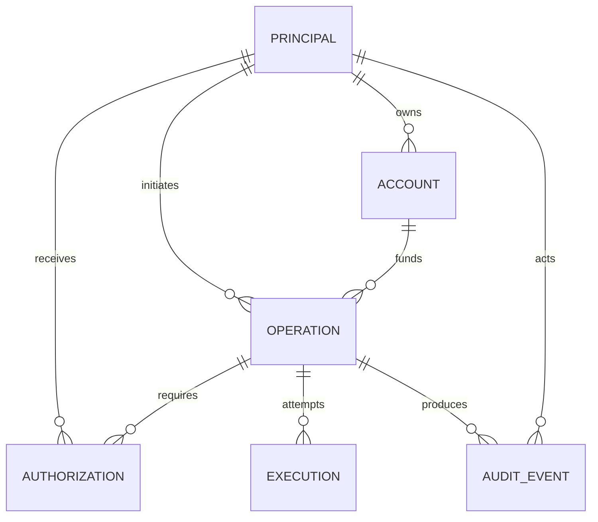

# Архитектура испытательного стенда

**Статус:** черновой проект MVP по материалам КТ1 и пяти пилотным инцидентам

Проект намеренно остаётся технологически нейтральным. Он фиксирует минимальные
сущности, состояния и границы компонентов, но пока не определяет язык
программирования, СУБД, HTTP-фреймворк и конкретную блокчейн-платформу.

Наглядные версии архитектуры и процессов:

- [архитектура испытательного стенда](diagrams/stand-architecture.md);
- [жизненный цикл банковской криптооперации](diagrams/operation-lifecycle.md);
- [цикл агентного тестирования](diagrams/agent-testing-cycle.md).

## Общий поток

```text
AI-агент
   ↓ действия
Интерфейс банка
   ↓
Права, лимиты и согласования
   ↓
Внутренний учёт: балансы и заявки
   ↓
Подпись транзакции
   ↓
Блокчейн
```

Независимый модуль сравнивает внутреннее состояние банка с результатом в
блокчейне и проверяет контрольные правила.

## Компоненты

- **AI-агент** получает наблюдаемое состояние и выбирает допустимое действие.
- **Интерфейс банка** принимает запрос и возвращает результат операции.
- **Права, лимиты и согласования** определяют, можно ли продолжать операцию.
- **Внутренний учёт** хранит балансы клиентов, заявки и изменения состояния.
- **Модуль подписи** создаёт тестовую подпись для разрешённой транзакции.
- **Блокчейн** моделирует активы, хранение и операции обмена.
- **Независимая проверка** оценивает фактическое состояние, а не ответ агента.
- **Журнал событий** сохраняет действия для воспроизведения сценария.

## Принцип первой версии

Первая версия строится только на общих свойствах пяти пилотных инцидентов:

- поручение должно иметь владельца, инициатора и уникальный идентификатор;
- исполнение требует действующего разрешения;
- разрешение имеет область действия, лимит и срок;
- доверенный сервис должен иметь проверяемую идентичность и ограниченные
  полномочия;
- одна операция не должна исполняться повторно;
- изменения внутреннего учёта и блокчейна должны быть наблюдаемыми.

Новые сущности и компоненты добавляются только тогда, когда следующий класс
инцидентов нельзя выразить через эту модель без потери существенного поведения.

## Границы MVP

### Входит в первую версию

- один тестовый актив;
- внутренние счета клиентов и один банковский блокчейн-кошелёк;
- создание, авторизация, исполнение и отмена операции;
- подпись или иное разрешение, nonce, срок действия и лимит;
- роли клиента, сотрудника, исполнителя и доверенного сервиса;
- регистрация и отзыв полномочий доверенного сервиса;
- простая блокчейн-транзакция перевода;
- журнал событий, сброс состояния и независимая проверка правил;
- управляемое включение тестовых ошибок для воспроизведения пяти инцидентов.

### Пока не входит

- реальный HSM, AML/KYT, холодное хранение и банковская бухгалтерия;
- несколько блокчейнов, мосты, оракулы и сложные DeFi-протоколы;
- полноценный workflow многоступенчатого согласования;
- реальные деньги, производственные ключи и персональные данные;
- точное копирование Argent, Safe, EtherFi и других исходных протоколов;
- оптимизация производительности и отказоустойчивость промышленного уровня.

## Минимальная модель данных

Модель описывает логические сущности. На первом этапе они могут храниться в
памяти или простой локальной базе данных.

| Сущность | Минимальные поля | Назначение |
| --- | --- | --- |
| `Principal` | `id`, `type`, `status` | Клиент, сотрудник, исполнитель или доверенный сервис |
| `Account` | `id`, `ownerId`, `kind`, `asset`, `balance`, `status` | Внутренний счёт или блокчейн-кошелёк, с которого движутся активы |
| `Operation` | `id`, `type`, `ownerId`, `initiatorId`, `executorId`, `sourceAccountId`, `destination`, `asset`, `amount`, `nonce`, `expiresAt`, `status` | Поручение, которое проходит авторизацию и исполнение |
| `Authorization` | `id`, `kind`, `subjectId`, `operationId`, `scope`, `limit`, `expiresAt`, `nonce`, `status`, `identityRef` | Подпись, роль, разрешение на списание или мандат доверенного сервиса |
| `Execution` | `id`, `operationId`, `attempt`, `status`, `chainTxId`, `errorCode`, `startedAt`, `finishedAt` | Каждая попытка исполнения и её фактический результат |
| `AuditEvent` | `id`, `operationId`, `actorId`, `eventType`, `timestamp`, `details` | Последовательность действий и решений для воспроизведения сценария |

`identityRef` — абстрактная ссылка на проверяемую идентичность сервиса. В
блокчейн-варианте это может быть адрес и хеш кода; во внутреннем сервисе —
идентификатор клиента, ключ или сертификат.



## Состояния операции

```text
DRAFT
  → PENDING_AUTHORIZATION
  → AUTHORIZED
  → EXECUTING
  → COMPLETED

Из промежуточных состояний возможны:
  → REJECTED
  → CANCELLED
  → FAILED
```

- `REJECTED` означает, что правило или авторизация не позволили начать
  исполнение.
- `FAILED` означает, что разрешённое исполнение началось, но не завершилось.
- После `COMPLETED` повторный запуск той же операции запрещён.
- Любой переход состояния создаёт `AuditEvent`.

## Базовые инварианты

1. Владелец операции и её инициатор должны быть определены явно.
2. Критические параметры операции нельзя менять после авторизации.
3. Пара `(ownerId, nonce)` должна быть уникальна.
4. Истёкшее, отозванное или неподходящее разрешение нельзя использовать.
5. Исполнитель и доверенный сервис должны иметь полномочие именно на эту
   операцию и её параметры.
6. Сумма исполнения не может превышать разрешение и доступный баланс.
7. Операция в состоянии `COMPLETED` не может изменить состояние повторно.
8. Отмена возвращает средства только заранее разрешённому получателю.
9. Внутренний баланс и подтверждённое блокчейн-движение должны быть
   согласованы.

## Логический контракт Bank API

На этом этапе фиксируются команды, а не HTTP-маршруты. Транспорт можно выбрать
при реализации.

| Команда | Назначение | Минимальный результат |
| --- | --- | --- |
| `createOperation` | Создать поручение от имени владельца | Идентификатор и состояние операции |
| `authorizeOperation` | Добавить подпись, роль или мандат | Принятая авторизация либо код отказа |
| `executeOperation` | Проверить правила и выполнить операцию | Состояние исполнения и `chainTxId`, если он появился |
| `cancelOperation` | Отменить операцию по разрешённым правилам | Конечное состояние и получатель возврата |
| `grantAuthorization` | Выдать ограниченное разрешение участнику или сервису | Идентификатор, область и срок разрешения |
| `revokeAuthorization` | Отозвать разрешение | Новое состояние разрешения |
| `registerTrustedService` | Зарегистрировать идентичность и полномочия сервиса | Идентификатор сервиса и допустимые действия |
| `getState` | Получить наблюдаемое состояние для теста или агента | Счета, операции и разрешения в разрешённом представлении |
| `resetStand` | Вернуть стенд к известной исходной точке | Идентификатор снимка состояния |

Минимальные коды отказа: `UNAUTHORIZED`, `AUTHORIZATION_EXPIRED`, `REPLAY`,
`LIMIT_EXCEEDED`, `EXECUTOR_NOT_ALLOWED`, `TARGET_NOT_ALLOWED`,
`INSUFFICIENT_FUNDS`, `INVALID_STATE`.

## Минимальные смарт-контракты

Смарт-контракты не копируют пять исходных протоколов. Они дают стенду
наблюдаемое блокчейн-состояние и несколько точек для проверки безопасности.

1. **`TestToken`** — простой тестовый актив с управляемой начальной эмиссией.
2. **`BankVault`** — хранит тестовые активы банка, исполняет разрешённый перевод
   и запоминает использованные идентификаторы операций.
3. **`AccessRegistry`** — хранит доверенные сервисы и ограниченные разрешения:
   область действия, лимит, срок и статус отзыва.

Очередь операций, внутренние клиентские балансы и аудит на первом этапе
остаются в эмуляторе банка. Переносить их в блокчейн следует только при
появлении исследовательской причины.

## Минимальная инфраструктура

```text
Тест или AI-агент
        ↓
Исполнитель сценариев
        ↓
Bank API
        ↓
Policy Engine ──→ хранилище состояния
        ↓                 ↓
Сервис исполнения ──→ журнал событий
        ↓
Программная подпись
        ↓
Blockchain Adapter
        ↓
TestToken + BankVault + AccessRegistry

Независимый Oracle читает хранилище, блокчейн и журнал,
но не участвует в принятии решения об операции.
```

## Связь пилотных инцидентов с моделью

| Инцидент | Основные поля и компоненты MVP | Проверяемая ошибка |
| --- | --- | --- |
| Argent | `Operation.nonce`, `expiresAt`, `Authorization`, `BankVault` | Повторное исполнение и просроченная подпись |
| SafeApprovalSquat | `Authorization.identityRef`, `limit`, `expiresAt`, `AccessRegistry` | Разрешение пустому или подменённому адресу |
| FlashLoopAdapter | `Principal`, `Authorization.scope`, `AccessRegistry`, Policy Engine | Самоавторизация сервиса и произвольная цель вызова |
| EtherFiAtomicQueue | `executorId`, связанное с операцией разрешение, Policy Engine | Назначение исполнителя без согласия и чужой allowance |
| OrderFactory | `ownerId`, `initiatorId`, `amount`, `nonce`, получатель отмены | Создание и отмена поручения без согласия клиента |

Эта таблица показывает достаточность базовой модели для пилота, но не означает,
что она покрывает весь корпус DeFiHackLabs.

## Контрольные правила первой версии

1. Операцию нельзя создать или исполнить без согласия её владельца.
2. Нельзя вывести больше доступного баланса или разрешённого лимита.
3. Одна операция и один nonce не должны исполняться более одного раза.
4. Истёкшее или отозванное разрешение не должно действовать.
5. Исполнитель и доверенный сервис должны иметь право на конкретное действие.
6. После авторизации нельзя подменить сумму, получателя или цель вызова.
7. Отмена не может направить средства произвольному получателю.
8. Внутренние записи банка должны соответствовать результату в блокчейне.

## Жизненный цикл операции

1. Создание операции клиентом, сотрудником или доверенным сервисом.
2. Проверка владельца, инициатора, nonce, срока и доступного баланса.
3. Добавление требуемой авторизации.
4. Проверка исполнителя, области разрешения и лимита в Policy Engine.
5. Создание тестовой подписи и отправка команды в `BankVault`.
6. Получение результата блокчейн-транзакции.
7. Обновление внутреннего состояния и сохранение аудита.
8. Независимая проверка инвариантов модулем Oracle.

## Граница ВКР

Стенд воспроизводит логику этапов в упрощённом виде и не имитирует
инфраструктуру конкретного банка. Реальные AML-сервисы, HSM и холодное
хранилище не входят в первый MVP; при необходимости позднее они могут быть
добавлены как программные модели.

Пока технологический стек не выбран, здесь фиксируются только концептуальные
решения. Реализовывать второй блокчейн следует только в том случае, если он
необходим для выбранного сценария или исследовательского вопроса.

