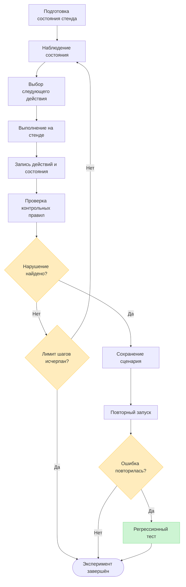

# Цикл агентного тестирования

Схема показывает не бизнес-процесс банка, а ход одного эксперимента: как агент
получает состояние, действует, проверяет результат и строит следующий шаг с
учётом предыдущих наблюдений.

## Короткое описание

Агент видит только разрешённую часть состояния стенда и выбирает очередное
действие. После выполнения независимый модуль проверяет контрольные правила:
например, отсутствие двойного исполнения или соответствие внутреннего баланса
состоянию блокчейна. Если нарушение найдено, вся последовательность сохраняется
и запускается повторно. В результат эксперимента попадают только
воспроизводимые нарушения; для них формируется регрессионный тест.
