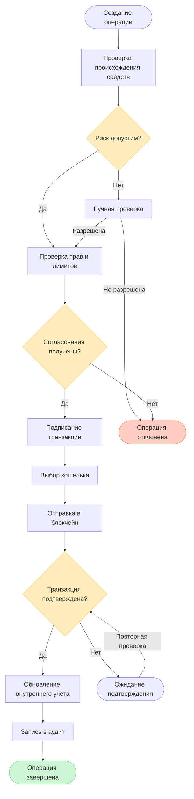

# Жизненный цикл банковской криптооперации

Схема показывает, через какие проверки проходит операция внутри стенда и в
каких точках она может быть отклонена или отправлена на ручную проверку.

## Короткое описание

Операция последовательно проходит проверку риска, правил и необходимых
согласований. Только после этого система создаёт подпись и отправляет
транзакцию в блокчейн. Внутренний баланс изменяется после подтверждения
транзакции, а все действия сохраняются в журнале аудита. Агент будет пытаться
найти последовательность действий, при которой один из этих этапов работает
неправильно или обходится.
