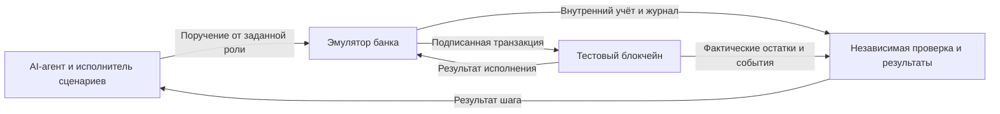
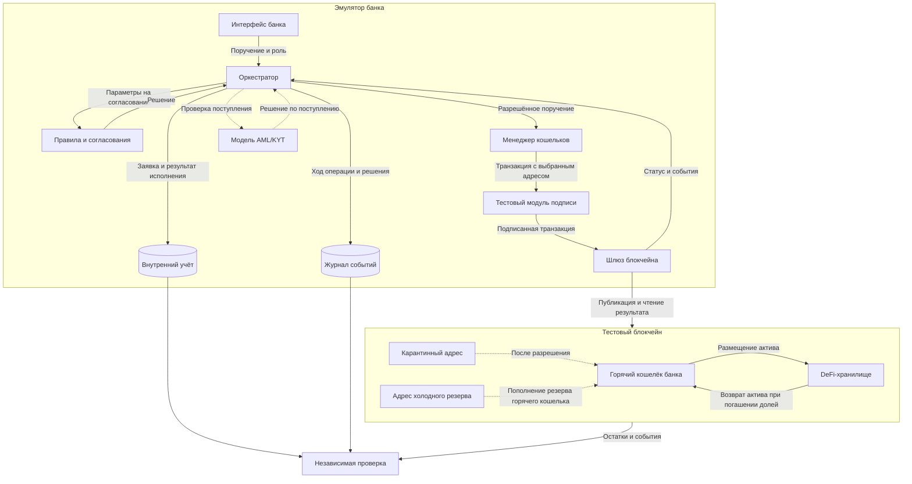

# Архитектура испытательного стенда

Первая схема показывает, кто испытывает банк и кто оценивает результат. Вторая раскрывает устройство банковского эмулятора и его связь с тестовым блокчейном. Использован принцип детализации C4. Блоки второй схемы обозначают логические функции, которые можно реализовать в одном приложении.

## 1. Контекст эксперимента

Агент действует через интерфейс банка. Проверяющий модуль читает состояние сети самостоятельно. Так можно обнаружить случай, когда банк сообщил об успехе, а активы остались на прежнем адресе.

## 2. Внутреннее устройство стенда

Для конкретности показан вариант, в котором банк размещает тестовый актив в DeFi-хранилище и погашает полученные доли. Пунктиром отмечены дополнения для других сценариев. Подробный порядок действий вынесен в [схему жизненного цикла операции](operation-lifecycle.md).

Стрелки между адресами показывают движение активов. Ключ горячего кошелька использует модуль подписи. Менеджер выбирает адрес **до подписания**, чтобы согласование и подпись относились к одной операции. Для холодного резерва предполагается отдельная процедура авторизации и подписания.

## Узлы и их назначение

| Узел | Назначение | Что делает в стенде |
|---|---|---|
| AI-агент | Выбор действия | Получает наблюдение по эксперименту и выбирает следующий шаг. |
| Исполнитель сценариев | Проведение эксперимента | Отправляет выбранное действие через интерфейс банка от заданной роли. |
| Интерфейс банка | Приём поручений и согласований | Связывает запрос с инициатором и передаёт его оркестратору. Клиент и сотрудники представлены ролями. |
| Оркестратор | Управление жизненным циклом | Связывает поручение, решение по нему и результат в сети. Передаёт подтверждённый результат в учёт. |
| Правила и согласования | Допуск к исполнению | Проверяет полномочия, лимит и требуемые подтверждения для конкретных параметров поручения. |
| Менеджер кошельков | Подготовка транзакции | Выбирает кошелёк и передаёт разрешённые параметры на подпись. |
| Тестовый модуль подписи | Подпись от имени банка | Использует тестовый ключ. Моделирует границу доступа к ключу без аппаратного HSM. |
| Шлюз блокчейна | Связь банка с сетью | Публикует транзакцию, отслеживает её исполнение и возвращает события банку. |
| Тестовый блокчейн | Исполнение и фиксация результата | Хранит состояние адресов, контрактов и результаты транзакций. |
| Горячий кошелёк | Текущие операции | Адрес банка, с которого поступает актив и на который возвращаются средства при погашении долей. |
| DeFi-хранилище | Размещение актива | Контракт сценария принимает актив, начисляет доли и возвращает актив при их погашении. |
| Внутренний учёт (ledger) | Учёт заявок и клиентских позиций | Связывает сетевую операцию с клиентом и отражает изменение его позиции. |
| Журнал событий | История решений банка | По идентификатору поручения связывает инициатора, согласования, сведения о подписании и результат в сети. |
| Независимая проверка | Оценка результата | Сопоставляет проводки, журнал и события сети. Например, проверяет, что повторная доставка одного подтверждения не создала вторую проводку. |
| Хранилище результатов | Сохранение эксперимента | Сохраняет сценарий, наблюдения и результат проверки. На первой схеме входит в блок независимой проверки. |

### Когда нужны дополнительные узлы

| Узел | Назначение | Сценарий, который обосновывает включение |
|---|---|---|
| Модель AML/KYT | Оценка риска поступления | В эксперименте с внешним переводом возвращает заданное решение о допуске, ручной проверке или блокировке. |
| Карантинный адрес | Изоляция поступивших средств | Нужен для проверки, что до разрешения средства остаются отдельно от доступной ликвидности. |
| Холодный резерв | Хранение средств с отдельным порядком доступа к ключу | Нужен для проверки пополнения горячего кошелька из резерва с усиленным согласованием. Сетевой адрес виден в блокчейне, изолируется средство подписи. |

Для первой проверки размещения и погашения достаточно задать начальный остаток горячего кошелька. AML/KYT и карантин добавляются при переходе к приёму внешних поступлений, холодный резерв — при переходе к управлению ликвидностью. Это проектные решения о границах эксперимента. Общие предпосылки описаны в [черновике архитектуры](../architecture.md).
