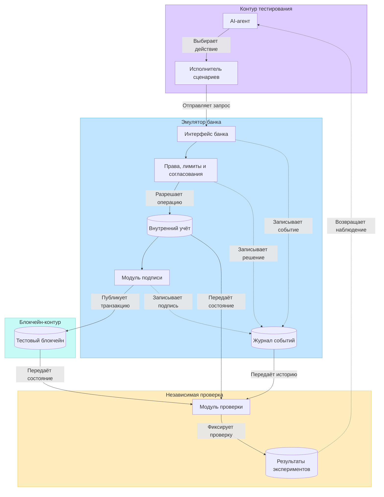

# Архитектура испытательного стенда

Схема показывает состав стенда и границу между тестирующим агентом, упрощённой
банковской системой, блокчейном и независимой проверкой результата.

## Как читать схему

1. Агент не обращается к базе данных или блокчейну напрямую: он действует через интерфейс банка.
2. Эмулятор банка проверяет права, лимиты и согласования, меняет внутренний учёт и подписывает разрешённую транзакцию.
3. Независимый модуль сопоставляет внутренний учёт, состояние блокчейна и журнал событий.
4. Результат проверки становится новым наблюдением агента и сохраняется для последующего анализа.

Реальные HSM, AML-сервисы и холодное хранилище в первой версии заменяются
программными моделями. Схема описывает исследовательский стенд, а не
инфраструктуру конкретного банка.

## Узлы системы и их назначение

### Моделируемая банковская система

- **Интерфейс банка** — принимает запросы на операции и предоставляет агенту
  только разрешённые способы взаимодействия с системой.
- **Права, лимиты и согласования** — проверяет роль инициатора, ограничения
  операции и наличие необходимых подтверждений.
- **Внутренний учёт** — хранит заявки, клиентские балансы и состояние операций
  с точки зрения банка.
- **Модуль подписи** — создаёт тестовую цифровую подпись только для операции,
  которая прошла предыдущие проверки.
- **Журнал событий** — сохраняет действия, решения и изменения состояния для
  аудита и точного воспроизведения сценария.
- **Тестовый блокчейн** — принимает подписанные транзакции и хранит фактическое
  состояние блокчейн-активов.

### Контур тестирования

- **AI-агент** — наблюдает доступное состояние и выбирает следующее действие с
  учётом результатов предыдущих шагов.
- **Исполнитель сценариев** — преобразует выбранное действие в запрос к
  интерфейсу банка и управляет последовательностью шагов эксперимента.

### Контур независимой проверки

- **Модуль проверки** — сопоставляет внутренний учёт, состояние блокчейна и
  журнал событий и определяет, нарушено ли контрольное правило.
- **Результаты экспериментов** — сохраняют найденные нарушения, сценарии их
  воспроизведения, метрики и служебную информацию о запуске.

Узлами исследуемой банковской системы считаются компоненты эмулятора банка и
блокчейн-контура. AI-агент, исполнитель сценариев и
независимая проверка относятся к испытательной инфраструктуре и не должны
смешиваться с узлами банка при классификации реальных инцидентов.
